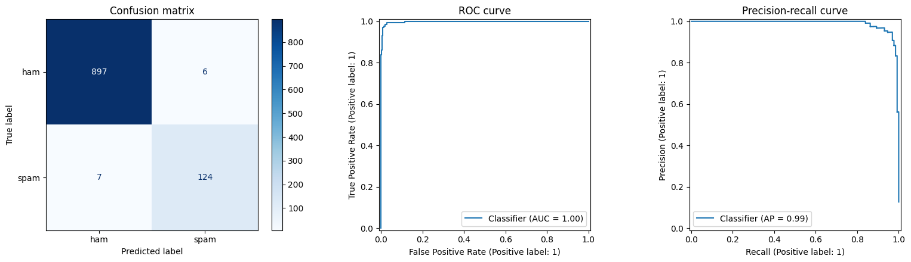
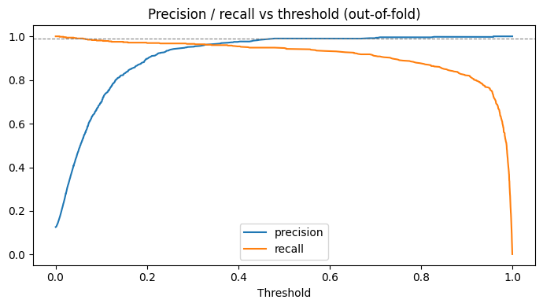
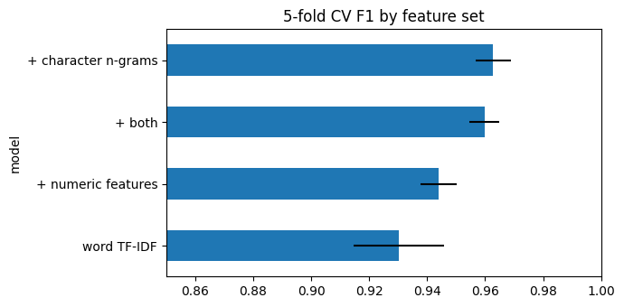
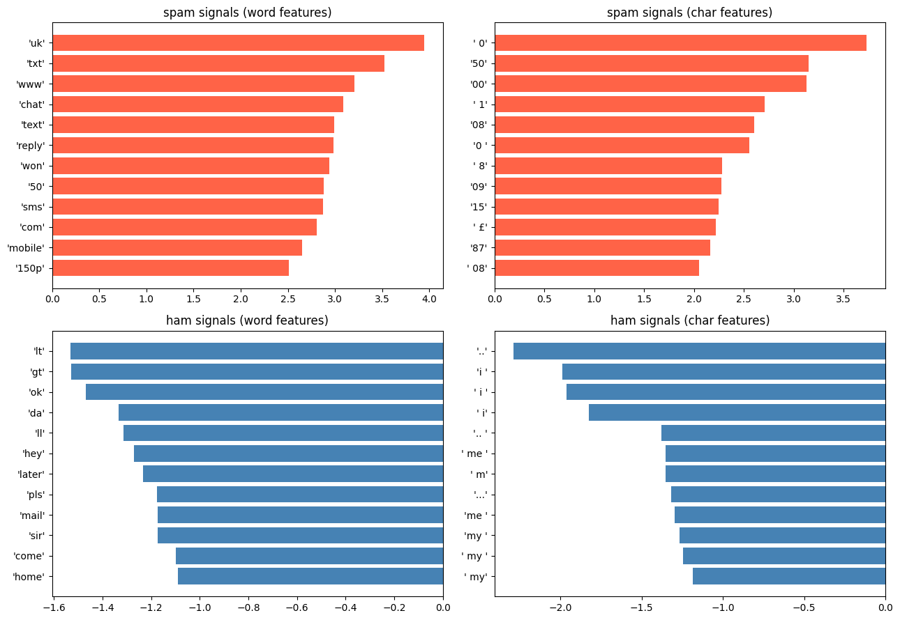

# SMS Spam Message Detector

A text-classification project that flags spam messages using word and character TF-IDF features with Logistic Regression. It includes a leakage-safe evaluation, feature ablation, error analysis, a decision threshold chosen from a business constraint, and a Streamlit app that explains each prediction.

## Results

Held-out test set: 1,034 messages (131 spam), after removing 403 duplicate messages.

| Metric (spam class) | Threshold 0.50 | Tuned threshold 0.69 |
|---|---|---|
| Precision | 0.954 | **0.968** |
| Recall | **0.947** | 0.908 |
| F1 | **0.950** | 0.937 |
| Legitimate messages flagged as spam | 6 | **4** |
| Spam missed | **7** | 12 |

Accuracy at 0.50 is 98.7% and ROC AUC is 0.998. A model that always predicts "ham" already scores 87.3% accuracy, so the numbers that matter are precision and recall on the spam class.



### Why a tuned threshold?

Flagging a real message as spam is the expensive mistake, especially if a bot or inbox rule acts on the flag. The threshold was picked on out-of-fold predictions from the **training** data as the lowest value that keeps precision at or above 99% from that point upward. On the held-out test set the same threshold gives 96.8% precision, a bit under the target: with only a handful of false alarms (4 here), the estimate is noisy. The trade-off is real, so the app lets you move the threshold and see the effect.



## How the model was built

1. **Clean**: drop 403 exact duplicate messages before splitting, so the same text cannot appear in both train and test.
2. **Compare classifiers** on word TF-IDF with 5-fold stratified cross-validation (training split only):

   | Model | Precision | Recall | F1 |
   |---|---|---|---|
   | Linear SVM | 0.954 | 0.897 | 0.924 |
   | Logistic Regression | 0.920 | 0.914 | 0.917 |
   | Random Forest | 0.991 | 0.809 | 0.890 |
   | Naive Bayes | 1.000 | 0.753 | 0.859 |

   Logistic Regression was kept: its F1 is within one standard deviation of the best, it returns probabilities (needed for the threshold) and its coefficients are readable.
3. **Feature ablation** with Logistic Regression and the same folds. Character n-grams gave the biggest gain; numeric features helped less and added nothing on top.

   | Features | CV F1 |
   |---|---|
   | Word TF-IDF | 0.930 |
   | + numeric (length, digits, capitals) | 0.944 |
   | **+ character n-grams** | **0.963** |
   | + both | 0.960 |

   
4. **Tune** `C`, `min_df` and the character n-gram range with grid search (best CV F1 0.968), then evaluate once on the test set.

## What the model learned

Character patterns pick up things single words miss: digit groups like `08`, `09`, `00` and the `£` sign push toward spam (premium phone numbers and prices), while first-person words (`i`, `me`, `my`) and ellipses `..` push toward ham.



Known weaknesses: very short shortcode spam (`ringtoneking 84484`) is missed, and short friendly messages (`Glad to see your reply.`) can be flagged. Both are available as examples in the app.

## Project structure

```
Spam-Message-Detector/
├── data/
│   ├── sms.tsv
│   └── README.md                      # source and license
├── notebooks/
│   ├── 01_eda.ipynb                   # class balance, message features, frequent words
│   ├── 02_model_training.ipynb        # model comparison, ablation, tuning, test evaluation
│   └── 03_model_interpretation.ipynb  # feature signals, error analysis, threshold selection
├── app/
│   ├── app.py                         # Streamlit app
│   ├── spam_model.pkl                 # trained pipeline
│   └── config.json                    # tuned threshold and test metrics
├── assets/                            # figures used in this README
├── requirements.txt
└── README.md
```

## Quick start

```bash
pip install -r requirements.txt
cd app
python -m streamlit run app.py
```

The app has a single-message view with an explanation of the score, a batch mode (one message per line, CSV download), and a threshold slider.

## Reproduce

Run the notebooks in order from the `notebooks/` folder: `01_eda`, `02_model_training`, `03_model_interpretation`. Notebook 02 writes `app/spam_model.pkl` and notebook 03 writes `app/config.json`. If the app shows a scikit-learn version warning, re-run notebooks 02 and 03 to regenerate both files for your environment.

## Limitations

- Trained on English SMS messages from around 2011 and a limited set of sources. Modern spam and other languages will behave differently.
- No Arabic support: the stop-word list and vocabulary are English.
- The test set has only 131 spam messages, so the reported figures are approximate.

## Ideas to extend

- Compare against a small transformer model.
- Put the filter in front of an auto-reply bot so spam never triggers a reply.
- Add a sentiment step for legitimate messages to prioritise unhappy customers.

Data: SMS Spam Collection (UCI, CC BY 4.0). Code: MIT.
